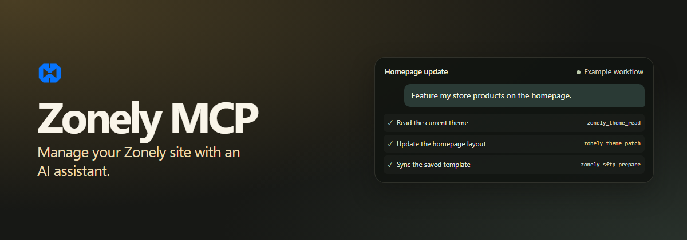

# Zonely MCP

Connect your Zonely control panel to an AI assistant. Manage site content, store operations, user accounts, and integrations. Edit themes through SFTP, consult the official documentation, and develop custom PHP modules from the same conversation.

[Download Zonely MCP](https://github.com/zonely-gen-tr/zonely-mcp/releases/latest) · [Zonely documentation](https://docs.zonely.gen.tr/) · [Report an issue](https://github.com/zonely-gen-tr/zonely-mcp/issues)

## What you can do

| Area | Example workflows |
| --- | --- |
| **Control panel** | Manage announcements, site titles and menus, accounts, stores, payments, support, and community categories. Look up member, order, and activity records. |
| **Store and game servers** | Create product categories, membership tiers, and in-game products. Set up supported payment and game-delivery integrations using the settings available on your site. |
| **Media library** | Upload site artwork, verify its published URL, and reuse the image in a page, announcement, or template. |
| **Themes and SFTP** | Create a private theme draft, edit templates over authorized SFTP, and verify saved theme changes. |
| **PHP modules** | Read Zonely's module rules, develop a PHP module and its templates, and prepare a ZIP for panel validation. Build a companion game-server plugin when the feature needs one. |
| **Documentation and database guidance** | Find panel workflows in 19 documentation languages, including guides for database administration in phpMyAdmin. |

The release includes background batch setup and a module installer with dedicated admin route and sidebar verification. Available actions depend on your site version, enabled features, connected integrations, and account permissions. Run phpMyAdmin database operations in your hosting panel.

## Installation

1. Download the ZIP from [Releases](https://github.com/zonely-gen-tr/zonely-mcp/releases/latest) and extract it. The package requires Node.js 24 or later.
2. Open the extracted folder in Codex and ask: **“Install Zonely MCP for my site and use English for the documentation.”** Follow the setup instructions included in the package.
3. Link your site profile and sign in to your Zonely panel when prompted. Try **“List the latest announcements on my site.”**

The package also includes local MCP setup instructions for Claude Code and other clients that support local stdio servers.

### Starting a new site

Ask for a trial preview for a domain you control. Sign in to your Zonely account and confirm the domain and the zero total before applying. The account's DNS guide then shows how to connect your domain. Once your site is ready, link it to your assistant.

## Example requests

> Create a private BoxPvP theme draft. Add an arena introduction and feature existing store products on the homepage.

> Upload this image to the media library, verify its published link, and use it on my game card.

> Check the module development guide. Design a player-activity map with a PHP module, a database, and a companion game-server plugin.

> Review my Survival store plan before creating the categories and membership tiers.

## Help and documentation

Use the official [Zonely documentation](https://docs.zonely.gen.tr/) for platform guides. See the [setup guide](SETUP.tr.md) for client configuration and site connection instructions.

## Source and license

Browse the [Zonely MCP source](src/) and the [installation instructions for coding assistants](AGENTS.md). Zonely retains all rights to its source and official releases. Installing and using an official copy is permitted under the [license](LICENSE). Redistribution requires prior written permission.
